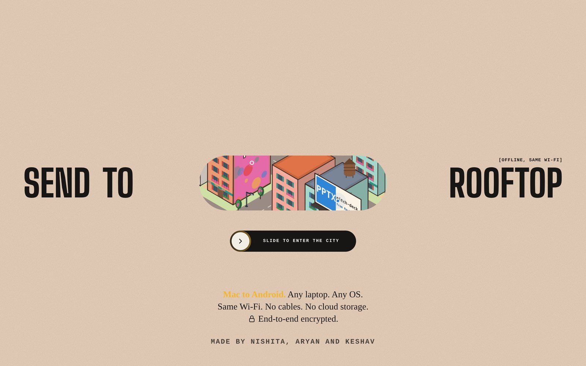
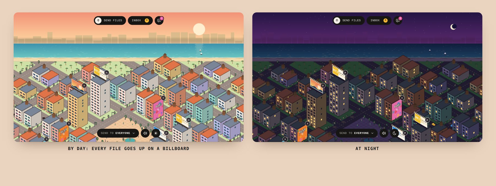
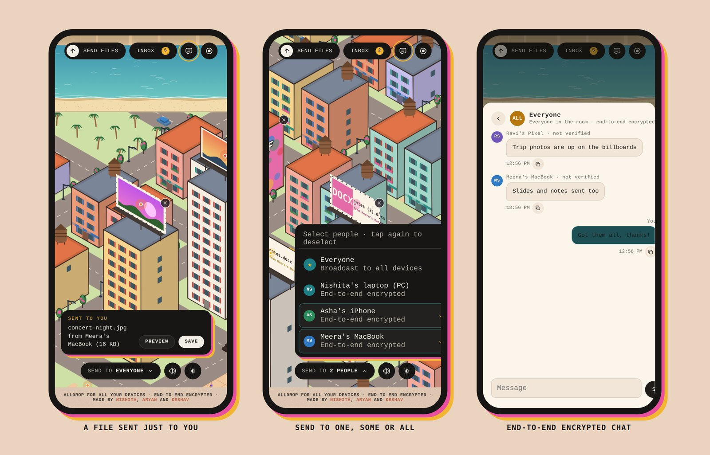
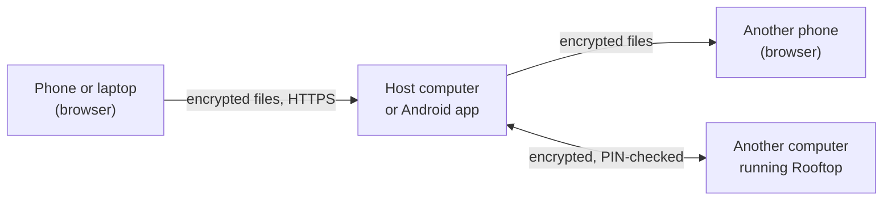

<p align="center"></p>

<h1 align="center">Rooftop</h1>

<p align="center"><b>AllDrop: AirDrop for all your devices.</b><br>
Mac to Android, iPhone to Windows, Linux to anything. Over your own Wi-Fi, end-to-end encrypted, no app to install on phones.</p>

<p align="center">Made by <b>Nishita</b>, <b>Aryan</b> and <b>Keshav</b></p>

---

## Why Rooftop

- **Any device to any device.** One computer runs Rooftop; every phone, tablet and laptop on the same Wi-Fi joins from its browser by scanning a QR code.
- **Nothing leaves your network.** No account, no cloud, no internet needed. Files go over your Wi-Fi or a phone hotspot.
- **Private by default.** Files and chat are encrypted on the sender's device for the people they are meant for. The computer in the middle only passes on scrambled data.
- **Fun to use.** Every file lands on a billboard or a wall in a little city you can explore, by day or at night.

## A look around

<p align="center"></p>

<p align="center"></p>

## Get started

You need **Java 22 or newer** ([adoptium.net](https://adoptium.net)) on the computer that hosts. Nothing to build.

| Computer | Start Rooftop |
|---|---|
| Windows | double-click `start-windows.bat` |
| macOS | double-click `start-mac.command` (first time: right-click, Open) |
| Linux | `./start-linux.sh` |

Or from the project folder on any of them: `java src/rooftop/Main.java`

1. **On the computer**, open [http://localhost:8080](http://localhost:8080). You will see a QR code and a PIN.
2. **On each phone**, scan the QR code (or open the address shown and type the PIN). The first time, the browser says the connection is "not private": tap through it (*Advanced, Proceed* on Android, *Show details, visit this website* on iPhone). The connection is still encrypted; the certificate is simply made by your computer instead of a company.
3. **Send.** Tap **Send files**, pick files, and choose who gets them under **Send to**: everyone, one person, or a few.

Phones must be on the same Wi-Fi or hotspot as the computer. Some school, office and cafe networks keep devices apart; a phone hotspot works instead. If phones cannot connect, allow Java through the computer's firewall (Rooftop uses ports 8443/TCP for phones, 45454/UDP and 45455/TCP between computers).

### No computer around?

`Rooftop.apk` is an Android app (Android 10 and newer) that hosts a session on the phone itself. Other phones and iPhones join it the same way, through their browser.

## What you can do

- **Send to anyone, a few people, or everyone.** Files sent just to you are marked **FOR YOU** in your city.
- **Receive several files at once.** See how many are coming from whom, preview them, then **Receive all** or save them one by one.
- **Chat**, in a room for everyone, one to one, or in groups. Messages are end-to-end encrypted too.
- **Share text and the clipboard** between phone and computer.
- **Check who you are talking to.** Each pair of devices shows a six-digit safety code; compare it, or scan the other device's QR code, to be sure no one swapped a key.
- **See the history** of everything sent and received in the session, under Inbox.
- **Start fresh.** *End session, start new* gives a new PIN and QR code, disconnects everyone and clears the session.

## How it works



- **Browser to browser:** the sending browser encrypts each file with a fresh key, sealed separately for every chosen person (AES-256-GCM, keys exchanged with ECDH P-256). The host stores only the scrambled copy and deletes it once every recipient explicitly removes it from their Rooftop page. Browser download requests do not confirm a save. Remaining copies expire after an hour or when the session ends.
- **To the host itself:** the host's own page decrypts the file and saves it in `~/Rooftop`. Those files are stored like any other download.
- **Computer to computer:** the connection is set up with the receiving computer's PIN (SPAKE2), so a wrong PIN or someone in the middle fails before any data moves. Both computers show a matching safety code.

**Keeping strangers out.**

- **Joining:** the QR code carries a long random key that cannot be guessed. The six-digit PIN is only for typing by hand. Wrong PINs are limited to 10 per device and 20 a minute across the whole network, so guessing would take weeks. Phones that scan the QR code, or are already connected, are never slowed down.
- **The host's own page** at `localhost` needs no PIN, so it only answers this computer's own pages, never another website open in the browser. On Android, other apps on the phone cannot use it either.
- **Received files** can be saved, but never run as code inside Rooftop. A web page disguised as a photo or PDF is only offered as a download.
- **Fair use:** one device on the network cannot fill the host's disk or memory, flood the device list, or take up every connection.

**Honest limits.** The certificate is self-signed, which is why browsers warn the first time. The pages themselves come from the host, so a host running modified code could serve a dishonest page; the safety codes catch a swapped key, not a swapped page. The host can see roughly how big files are and when they are sent, but not their names or contents.

## Good to know

- After a host restart, existing inbox files are visible only to the host. Send them again to share them with other devices.
- Two people with the same name are told apart by a short tag, like *Asha · 2b74*. Someone who closed Rooftop is marked *inactive*, and a chat with someone who left says so instead of sending into nowhere.
- Keep the receiving page open while files are being saved. Phones can pause pages that are in the background.
- Files received in a phone's browser are kept in that page until you save them; reloading the page fetches them again from the host, while the host still has them.
- Received files stream into temporary browser disk storage where supported. If storage is unavailable, receiving uses a shared 64 MB memory limit and stops safely when full. Disk quota errors retain the host copy. Temporary disk files are cleaned on page close; crash leftovers are cleaned on the next receive.
- A browser may ask before saving several files in a row. Cancelling a download or share sheet keeps the encrypted host copy available until removal, expiry, or session end.
- The latest 500 browser transfer history entries survive reloads in the same tab and host session, if session storage is enabled. History contains metadata, not file contents; closing the tab clears it. The host's history lasts until the session ends.
- Manual retry resumes the same encrypted upload while the page and host session remain open. Reloading the sender or changing the host session requires a new send.

## For developers

```
src/rooftop/     Java host: networking, transfers, sealed storage, security (SPAKE2, PIN guard)
web/             the page: city renderer (app.js), styles, end-to-end encryption (e2e.js)
android/         Android host app and its build script
test/            browser checks (Playwright)
```

Run the checks:

```bash
java src/rooftop/SelfTest.java
```

The browser checks need Playwright and a running Rooftop. They use their own test devices, but `test/e2e-browser.mjs` only runs its session-reset part with `ROOFTOP_TEST_RESET=1`, because ending a session deletes the host's received files.

```bash
node test/e2e-browser.mjs
node test/chat-browser.mjs
node test/batch-browser.mjs
node test/transfer-state.mjs
node test/layout-check.mjs
node test/twins-browser.mjs
node test/file-type-browser.mjs
```

Set `ROOFTOP_PLAYWRIGHT=/path/to/playwright/index.mjs` if Playwright is not installed in the project, and `ROOFTOP_BROWSER_CHANNEL=chrome` to use the Chrome already on the computer.

Build the Android app (needs a JDK and the Android SDK with platform 35 and build-tools 35.0.0):

```bash
sh android/build.sh
```

Keep `android/rooftop-release.keystore` safe: Android only installs updates signed with the same key.

## Credits

Fonts and icons are listed in [THIRD_PARTY.md](THIRD_PARTY.md).
