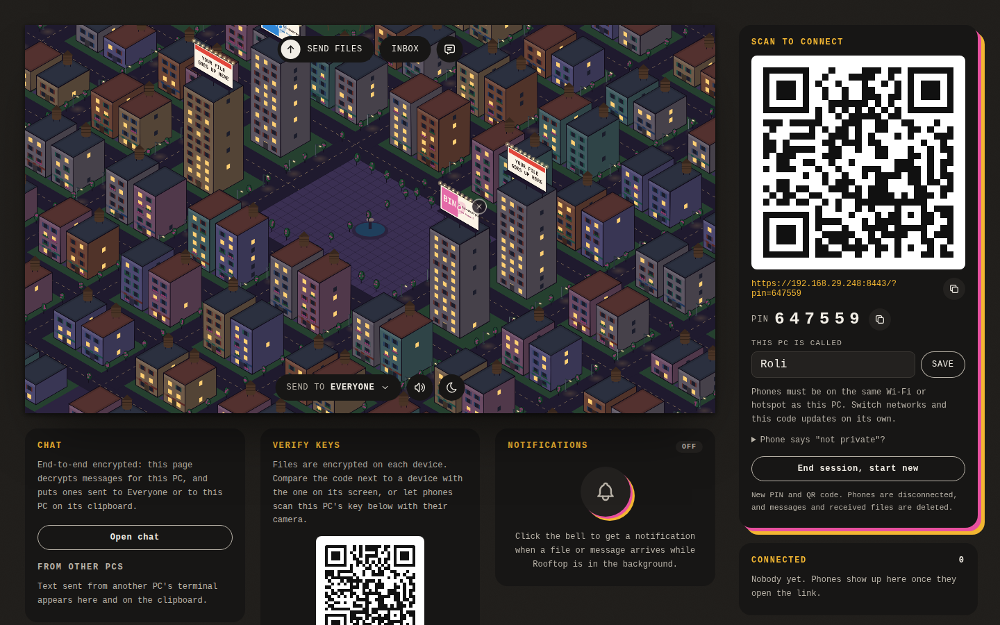
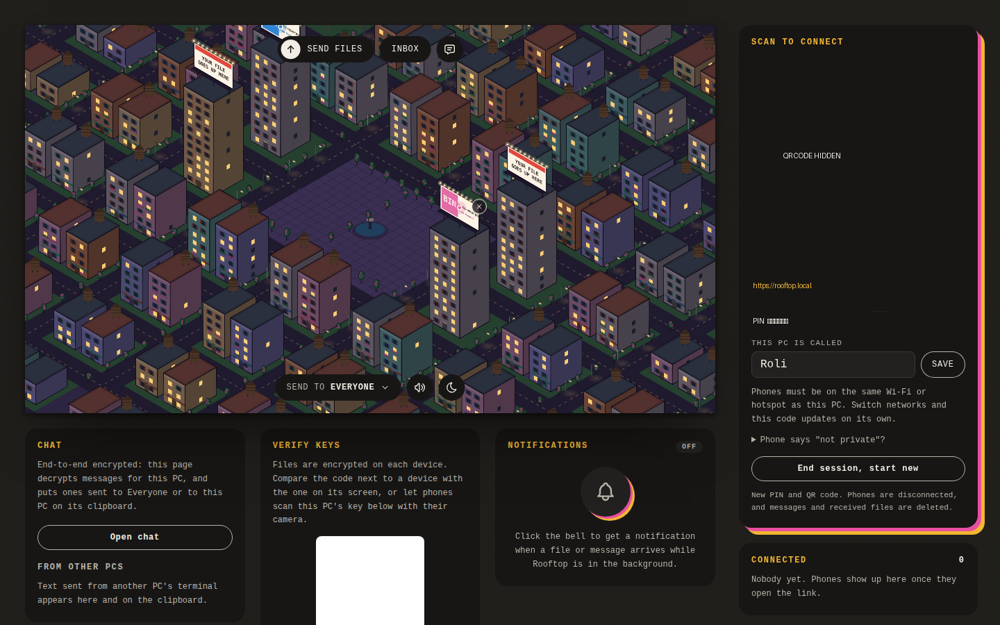

# Rooftop

**Move files between Mac, Android, Windows, Linux and iPhone on the same local network.** Rooftop is a small, open-source, AirDrop-style transfer app with a playful rooftop city. No account, cables, cloud upload or phone app required: phones and tablets join from their browser.

> Rooftop uses your local Wi-Fi or hotspot. Browser-to-browser files are encrypted end to end; the host temporarily relays encrypted copies and removes them after recipients save them or the relay expires them. Files you download stay on your devices. The host's own inbox stores files it receives in the usual way.

## Screenshots

**City and rooftop murals**



**Connect devices**



## Get started

You need Java 22 or newer on the computer that hosts the session.

**Linux:**

```bash
./start-linux.sh
```

**macOS:** open `start-mac.command` (first time: right-click, Open). **Windows:** double-click `start-windows.bat`.

Or, from the project folder on any desktop OS:

```bash
java src/rooftop/Main.java
```

The host opens Rooftop at [http://localhost:8080](http://localhost:8080). On a phone, scan the QR code shown in the host panel. Accept the browser's first-visit certificate warning: Rooftop uses a self-signed certificate for its local HTTPS connection. The QR code and PIN are for the current session; share them only with people you want to connect.

Select **Send files**, choose one or more files, then choose Everyone or tap individual people under **Send to**. The recipient sees the incoming file count and transfer progress. Their files appear in the inbox and on their rooftop; they can preview them or choose **Receive all**. A browser may ask permission before downloading multiple files.

## What it does

- Sends files to Everyone or a chosen set of connected devices. Up to three files upload or decrypt at once.
- Shows direct-to-you files with a **FOR YOU** label; senders see **TO <recipient>** on direct transfers.
- Keeps a session history under **Inbox → History**, including browser-to-browser transfers and transfers whose files were removed.
- Transfers clipboard text and provides end-to-end encrypted room, private and group chat.
- Lets phones join from their browser and lets the Android app host a session itself.
- Runs on a local network, without a cloud account or file-hosting service.

Browser transfer history lasts until that browser reloads. The host's session history lasts until the session ends. Mobile browsers can restrict background work, audio before a user gesture, and multiple downloads. Keep the receiving page open while files are being saved.

## Android app

`Rooftop.apk` is the Android host app (Android 10+). Install it on an Android device to host Rooftop without a computer; other devices join through the QR code in the app. Build it yourself with an Android SDK (platform 35, build-tools 35.0.0) and JDK:

```bash
sh android/build.sh
```

The build writes `Rooftop.apk` in the project root. The signing key is `android/rooftop-release.keystore`; keep the same key to install future APK updates over the existing app.

## Network and privacy

All devices need to be reachable on the same Wi-Fi or phone hotspot. Some public, school or office Wi-Fi networks isolate connected devices; a hotspot is a useful alternative. Allow Rooftop through the computer's firewall if devices cannot connect.

| Port | Purpose |
|---|---|
| 8080 | Host's local web page |
| 8443/TCP | HTTPS for phones and browsers |
| 45454/UDP | Discover other Rooftop computers |
| 45455/TCP | Encrypted computer-to-computer transfers |

Browser-to-browser files are encrypted on the sender's device for each chosen recipient. The host relays ciphertext, not file contents, and deletes it once recipients acknowledge their copies. Uncollected phone copies expire after one hour. A file addressed to the host is retained until its own page opens and saves it. Files received by the host are saved in `~/Rooftop` and are not encrypted at rest by Rooftop.

Phone-to-host web traffic uses HTTPS. Computer-to-computer transfer uses a PIN-checked key exchange and AES-GCM encryption. The self-signed certificate warning is expected; verifying a device's safety code helps detect a changed device key. As with any app served by a host, a compromised host could serve modified browser code.

## Project layout

- `web/` — browser UI, city renderer and end-to-end encryption.
- `src/rooftop/` — Java desktop host, networking, transfer queue and security.
- `android/` — Android host app and APK build script.
- `test/` — browser-based checks; `src/rooftop/SelfTest.java` checks Java security and transfer behavior.

## Checks

```bash
java src/rooftop/SelfTest.java
```

Browser checks need Playwright and a local Rooftop host. With Rooftop running, use:

```bash
ROOFTOP_PLAYWRIGHT=/path/to/playwright/index.mjs node test/e2e-browser.mjs
ROOFTOP_PLAYWRIGHT=/path/to/playwright/index.mjs node test/chat-browser.mjs
ROOFTOP_PLAYWRIGHT=/path/to/playwright/index.mjs node test/batch-browser.mjs
```

The session-reset section in `e2e-browser.mjs` is opt-in (`ROOFTOP_TEST_RESET=1`) because ending a session deletes the host's received files.

## Credits

See [THIRD_PARTY.md](THIRD_PARTY.md) for font and icon licenses.
